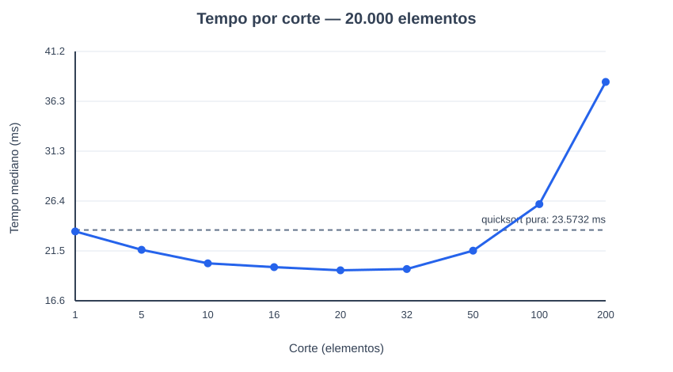

# Relatório — quicksort híbrida

## Implementação

Implementei a quicksort com pivô escolhido aleatoriamente em cada partição. A partição de três vias mantém os valores menores, iguais e maiores que o pivô em regiões contíguas; apenas as regiões dos menores e maiores são processadas novamente. Quando um trecho tem **menos de `corte` elementos**, uso insertion sort nesse próprio trecho. O parâmetro `corte` faz parte da função `quicksort_hibrida`.

## Medição

Usei 20.000 inteiros pseudoaleatórios de 0 a 999.999, gerados uma vez com a semente `20261022`. Para cada corte e para a quicksort pura, ordenei uma cópia da mesma lista nove vezes. Em cada repetição, a semente do pivô foi a mesma entre as configurações; a ordem das configurações foi embaralhada para reduzir o efeito de aquecimento e carga momentânea. Registrei a mediana do tempo de ordenação em milissegundos. A cópia e a conferência do resultado ficaram fora do trecho cronometrado. Todas as saídas foram comparadas com `sorted(dados)`.

Ambiente desta execução: Python 3.12.14, Windows 11. Tempos absolutos variam conforme computador, interpretador e carga do sistema.

## Tabela de resultados

| Corte | Tempo mediano (ms) |
|---:|---:|
| 1 | 23,4347 |
| 5 | 21,6211 |
| 10 | 20,2876 |
| 16 | 19,9178 |
| **20** | **19,6018** |
| 32 | 19,7271 |
| 50 | 21,5395 |
| 100 | 26,1248 |
| 200 | 38,1706 |
| Quicksort pura | 23,5732 |

O **corte 20** apresentou o menor tempo medido: **19,6018 ms**. Em relação à quicksort pura, que levou **23,5732 ms**, a redução foi de **3,9714 ms**, ou **16,8%** do tempo de referência.

Com cortes grandes demais, a inserção recebe trechos maiores. Seu custo quadrático passa a dominar o ganho obtido pela redução das partições da quicksort. Neste ensaio, os cortes **100** e **200** foram mais lentos que a quicksort pura, e 200 foi o pior valor testado.

## Confirmação do corte 1

Na implementação, `quicksort_pura` chama `quicksort_hibrida` com `corte=1`. Como nenhum trecho não vazio tem menos de um elemento, a chamada à inserção nunca ocorre. Portanto, as duas funções executam a mesma sequência de partições para a mesma entrada e semente. A diferença de 0,1385 ms entre suas medianas decorre da variação normal das medições, não de uma mudança no algoritmo.

## Reprodução

O comando `python experimento.py` executa as nove repetições, confere a ordenação e gera `resultados.csv` e `grafico.svg`. Não há dependências externas além do Python 3.10 ou superior.
